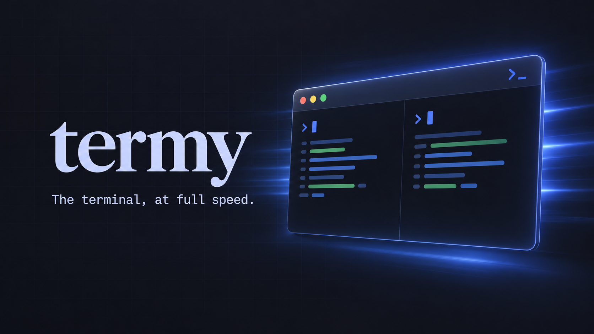

<p align="center">
  
</p>

<p align="center">
  <a href="https://github.com/lassejlv/termy/releases/latest"></a>
  <a href="https://github.com/lassejlv/termy/stargazers"></a>
  <a href="./LICENSE"></a>
</p>

<p align="center">
  <a href="https://termy.sh/download"><strong>Download</strong></a> ·
  <a href="https://termy.sh/docs"><strong>Documentation</strong></a> ·
  <a href="https://github.com/lassejlv/termy/releases"><strong>Releases</strong></a> ·
  <a href="./CONTRIBUTING.md"><strong>Contribute</strong></a>
</p>

Termy is a fast, native terminal for macOS, Linux, and Windows. It combines GPU-accelerated rendering with the terminal workflows you use every day—tabs, splits, search, tasks, layouts, themes, and optional tmux sessions—without turning the interface into a control panel.

- Damage-scoped GPU rendering with dirty-span cell caching
- Tabs, splits, search, tasks, and reusable layouts
- Configurable keybindings, colors, themes, and terminal behavior
- Optional tmux control-mode sessions
- Native platform integration with a reusable headless runtime and FFI

## Install

Download the latest build from **[termy.sh/download](https://termy.sh/download)** or browse every artifact on **[GitHub Releases](https://github.com/lassejlv/termy/releases)**.

macOS DMGs from v0.2.75 onward are signed and notarized. Open the DMG and drag
Termy to `/Applications`. See [macOS troubleshooting](https://termy.sh/docs/getting-started/troubleshooting)
if the app still does not open.

On Windows, run `Termy-<version>-windows-x64-Setup.exe` (or the `arm64` one on
ARM64 PCs). It installs for the current user without an administrator prompt;
pass `/ALLUSERS` or pick **Install for all users** to install under Program
Files. See the [installation guide](https://termy.sh/docs/getting-started/installation#windows)
for SmartScreen and winget notes.

### Video on Windows

Video inside Termy uses libVLC 3 from a `vlc` folder next to `termy.exe`. That
folder is not in git and Termy does not install VLC. The tested runtime is
official VideoLAN **3.0.24** for 64-bit Windows, not whatever the download page
lists as current:

[vlc-3.0.24-win64.zip](https://download.videolan.org/pub/videolan/vlc/3.0.24/win64/vlc-3.0.24-win64.zip)
`sha256 fcf30850371ad10c9373cc4f0f4501e7dee49e3e9ae9f20c72fb2661a1ca6323`

`scripts/windows/stage-libvlc.ps1` copies `libvlc.dll`, `libvlccore.dll`, and
the playback plugins into that folder. It does not copy `vlc.exe`, and it does
not change a VLC install already on the PC. Photos do not need it. If the
folder is missing or incomplete, video shows an error and does not open VLC or
mpv. A 32-bit tree is refused. When `vlc\libvlc.dll` sits beside Termy, that
copy is used even if VLC is also installed under `C:\Program Files\VideoLAN\VLC`.

The stage step also copies
[vlc-3.0.24.tar.xz](https://download.videolan.org/pub/videolan/vlc/3.0.24/vlc-3.0.24.tar.xz)
(`sha256 e7cab503d1d7d5849b89d2cf0e1ee60d0ef6d012407791b644b9cfc0cc225fdf`)
into `vlc\source`, plus `COPYING` and `COPYING.LIB` from that tree.
`COPYING.txt` in the binary archive is GPL-2.0. `COPYING.LIB` is LGPL-2.1.
libVLC's header is LGPL-2.1-or-later. `modules/codec/avcodec` is LGPL-2.1-or-later
and links FFmpeg. The stage step also copies `ffmpeg-8.1.2.tar.xz` from
VideoLAN's 3.0.24 win64 build artifacts after its sha512 matches
`contrib/src/ffmpeg/SHA512SUMS` in the VLC source, and the x264 snapshot
`e067ab0b530395f90b578f6d05ab0a225e2efdf9` named by `contrib/src/x264/rules.mak`.
`modules/codec/x264.c` and
`modules/control/dummy.c` are GPL-2.0-or-later. The x264/x265 encoder plugins
are left out. `libdummy_plugin.dll` stays because playback asks for
`--intf=dummy`. The stager also still copies other GPL-2.0-or-later plugins
(DirectShow, hotkeys, lua, and the rest listed in
`docs/architecture/release-packaging.md`). FFmpeg's own configure flags inside
`libavcodec_plugin.dll` were not recovered, so that plugin is not labeled GPL
here and is not labeled LGPL-only. The VLC source, the matching FFmpeg 8.1.2
archive, and the matching x264 snapshot are in `vlc\source`. Other contrib
archives are not, and nothing in this repo rebuilds the DLLs from those
archives. That is a legal review, not a failed build. Termy's license is
unchanged. `termy.exe` imports `msvcp140.dll`, `vcruntime140.dll`, and `vcruntime140_1.dll`.
The stage step places Microsoft's official x64 installer
`VC_redist.x64.exe` (file version 14.51.36247, sha256
`843068991daaa1f73ad9f6239bce4d0f6a07a51f18c37ea2a867e9beca71295c`)
in `prereqs` beside `termy.exe`. It does not run that installer and it does
not copy those DLLs out of System32. A machine that does not already have
them needs that executable run once. libVLC itself imports `msvcrt.dll`,
which is a Windows system DLL and is a different runtime.

### Build from source

Termy is a Rust workspace. Build and launch the desktop app with:

```bash
cargo run --release -p termy
```

See the [installation guide](https://termy.sh/docs/getting-started/installation) for platform-specific steps.

## What you can shape

Termy keeps its behavior in plain configuration rather than burying it in hidden application state.

| Surface | What you control |
| --- | --- |
| Appearance | Themes, colors, fonts, chrome contrast, and tab presentation |
| Input | Keybindings, terminal behavior, mouse reporting, and shortcuts |
| Workspace | Tabs, split panes, tasks, reusable layouts, and working directories |
| Sessions | Local shells and optional tmux-backed sessions |

Start with [Customize Termy](https://termy.sh/docs/customize) or use the complete [configuration reference](https://termy.sh/docs/reference/configuration-reference).

## Architecture

Termy is more than a window around a PTY. Its terminal emulation uses Termy's own streaming parser, screen storage, and native PTY runtime. The repository also contains a GPUI desktop application, CLI, native FFI, website, and release tooling.

```text
desktop / embedding hosts
        │
        ├── terminal UI and platform integration
        │
        ├── reusable command, search, theme, and release crates
        │
        └── terminal runtime, PTY, parser, and rendering snapshots
```

Read [Project Layout](./docs/architecture/project-layout.md) for ownership boundaries and [Release Packaging](./docs/architecture/release-packaging.md) for artifact flow.

## Sponsors

Termy is supported by companies and people who care about fast, native developer tools.

<p align="center">
  <a href="https://neon.tech">
    <picture>
      <source media="(prefers-color-scheme: dark)" srcset="./assets/legends/neon-logo-dark-color.svg" />
      <source media="(prefers-color-scheme: light)" srcset="./assets/legends/neon-logo-light-color.svg" />
      
    </picture>
  </a>
  &nbsp;&nbsp;&nbsp;&nbsp;
  <a href="https://github.com/mezotv">
    
  </a>
</p>

## Termy X

Termy X is a fork layer on [Termy](https://github.com/lassejlv/termy) (MIT, © Lasse Jørgensen). The terminal itself is unchanged. X reads, drafts, and publishing live in `crates/x_core` so upstream merges stay small. The desktop app gains a side panel; the CLI gains `termy x` and a standalone `x` binary.

No X API credits are needed. The official API is off unless you set `official_api.enabled = true`.

### Commands

```bash
x
x splash
x doctor
x timeline
x search "gpui" --recent --limit 10
x lookup @termy
x thread 1001
x trends --place worldwide
x popular gpui
x draft "ship the panel" --n 3 --tone punchy
x compose --text "hello from the terminal"
x post --dry-run "hello world"   # prints every part and never posts
x post "hello world"             # prints every part, then you type yes
x publish <draft-id> --dry-run
x research "gpui terminals"
termy x doctor                   # same commands through the Termy CLI
```

`--json` prints machine-readable output. `--provider mock` forces fixtures (what the tests use). Tones for `x draft` are `punchy`, `informative`, `thread`, and `reply`.

`x` and `x splash` print an original Unicode bird (blue and cyan, pink heart). `NO_COLOR` turns the ANSI colors off.

`x post` and `x publish` never post until you type `yes`. They print the exact text of every part first, with the weighted count of each part (twitter-text v3, limit 280). `--dry-run` prints the same plan, including which provider would be used, and does not ask and does not post. A thread sent through the web intent opens one intent at a time: each part is copied to the clipboard, then the CLI waits for `next`.

### Free providers

Reads try, in order:

1. [OpenCLI](https://github.com/jackwener/opencli) `twitter` adapter (`profile`, `thread`, `search`, `timeline`, `trending`, `whoami`). Uses your logged-in Chrome session and the Browser Bridge extension. Reads pass `--window background`. Termy X does not automate login or store passwords.
2. [twitter-cli](https://github.com/public-clis/twitter-cli), the X path used by [Agent Reach](https://github.com/Panniantong/Agent-Reach) (`user`, `tweet`, `search`, `feed`, `status`). Auth is your own cookie (`TWITTER_AUTH_TOKEN` and `TWITTER_CT0`, or the browser cookie jar). "Popular" is search ranked by engagement. Trends fall back to that ranking when a trends endpoint is missing.
3. Built-in mock fixtures, so the app and tests run with nothing installed.

Research (not an X credit) uses OpenCLI Reddit and YouTube search, `yt-dlp`, a web reader, and RSS.

Publishing tries, in order, and still requires you to type `yes`:

1. `opencli twitter post` / `opencli twitter reply`, only when `opencli twitter --help` lists `post`
2. `twitter post` / `twitter post --reply-to`, only when `twitter --help` lists `post`
3. An X web intent: `https://x.com/intent/post?text=...` (and `in_reply_to` on the first part). One intent per part. Termy X copies the part and opens the intent; you click Post.

`termy-xcli doctor` reports each free provider as `working`, `missing`, or `not logged in`, plus the AI endpoint. It says **No X API credits are needed.** It never posts and never logs in. Cookie and browser-session providers are labeled "uses your own logged-in session". On Windows, command shims resolve in PATHEXT order (`opencli.cmd` ahead of the extensionless shell script, then `.ps1`) and run with `CREATE_NO_WINDOW` so a console does not flash.

### Optional official API

Create an app at the X developer portal, set `official_api.enabled = true`, and export the client id:

```bash
export TERMY_X_CLIENT_ID=...
x auth
```

`x auth` prints an OAuth 2.0 PKCE authorize URL (scopes include `tweet.read` and `tweet.write`) and can exchange a code into the OS keychain (service `termy-x`) or a `0600` file. The localhost callback listener is not started for you; paste the redirect yourself only if you finish the exchange out of band. Cost figures in the status line are labeled estimates (post read $0.005, user read $0.010, post write $0.010) and are not a bill.

### AI drafts

Drafts stay drafts. Nothing is auto-posted.

The client is OpenAI-compatible. `TERMY_X_AI_BASE_URL`, `TERMY_X_AI_API_KEY`, and `TERMY_X_AI_MODEL` are the Termy names. `OPENAI_BASE_URL` and `OPENAI_API_KEY` are also accepted. With nothing set, Termy X tries a free local Ollama at `http://127.0.0.1:11434/v1` (model `llama3.2`). If nothing is reachable, `x draft` still returns offline templates labelled `template`.

```bash
# Ollama (the free default). Pull a small model once: ollama pull llama3.2
export TERMY_X_AI_BASE_URL=http://127.0.0.1:11434/v1
export TERMY_X_AI_MODEL=llama3.2

# LM Studio's local server
# export TERMY_X_AI_BASE_URL=http://127.0.0.1:1234/v1

# Groq free tier, or an OpenRouter model whose id ends in :free
# export TERMY_X_AI_BASE_URL=https://api.groq.com/openai/v1
# export OPENAI_BASE_URL=https://openrouter.ai/api/v1
# export OPENAI_API_KEY=...
x draft "ship the panel" --tone informative
```

Other free OpenAI-compatible servers: llama.cpp's `llama-server` and any local server that speaks `/v1/chat/completions`. Prompt text lives in `crates/x_core/prompts/default.toml`.

### Config

`x config` prints an example. The file is `~/.config/termy/x.toml`.

| Key | Default | Meaning |
| --- | --- | --- |
| `background_art` | `true` | Geometric swift behind the panel, and the CLI splash |
| `background_opacity` | `0.18` | Bird strength behind lists. The splash stays at full strength |
| `provider` | `auto` | `auto`, `opencli`, `twitter`, `mock`, or `official` |
| `default_limit` | `10` | Page size, clamped to 20 on the CLI |
| `official_api.enabled` | `false` | Turn on the paid API |
| `ai.base_url_env` | `TERMY_X_AI_BASE_URL` | Env var that holds the chat endpoint |
| `shell.min_interval_ms` | `1500` | Pause between shell-outs |

### Desktop panel

Open it with `Ctrl+Shift+X` (`Cmd+Shift+X` on macOS) or the command palette entries under X: Timeline, Search, Trends, Lookup, Compose, Research. Compose shows a live preview, the weighted counter, thread splits, and "Suggest variants". Publish opens a confirm dialog with the exact text of each part. "Next post" opens one web intent at a time. "Copy" copies that part. Nothing is posted automatically.

The background is an original low-poly swift (electric blue and cyan, magenta heart with a `+1`) in `assets/x/termy-x-bird.svg`, drawn for a 1600×1000 frame and scaled with object-fit cover. Behind lists it is drawn at `background_opacity` (default 0.18). The empty splash shows it at full strength. "Art on/off" writes `background_art` into `x.toml`. Turning art off skips rasterization. The CLI prints a small ANSI bird when that flag is on.

On a wide preview the panel is three columns (compose, results, trends). It drops to two columns, then one, as the window gets narrower.

Preview the panel on fixture data (no network):

```bash
cargo run -p termy --bin x_panel_preview -- --mock --width 1600 --height 1000
cargo run -p termy --bin x_panel_preview -- --splash
```

## Sync across PCs

In the X panel Help tab, **Account sync (optional)** takes an email and password. Sign in or Create account copies likes, follows, reposts, and receipts to your other signed-in PCs. The password is not saved. Sync stays off until you sign in, and this PC keeps working from its local database either way. Details are in [crates/x_core/README.md](crates/x_core/README.md#sync-across-pcs).

## Roadmap and contributing

- [Engineering quality roadmap](./docs/engineering/roadmap.md)
- [Contributor setup and validation](./CONTRIBUTING.md)

Contributions are welcome. Keep changes scoped, run the nearest validation command, and preserve the boundaries documented in the architecture guide.

<p align="center">
  <sub>MIT licensed · Built in Rust · <a href="https://termy.sh">termy.sh</a></sub>
</p>
